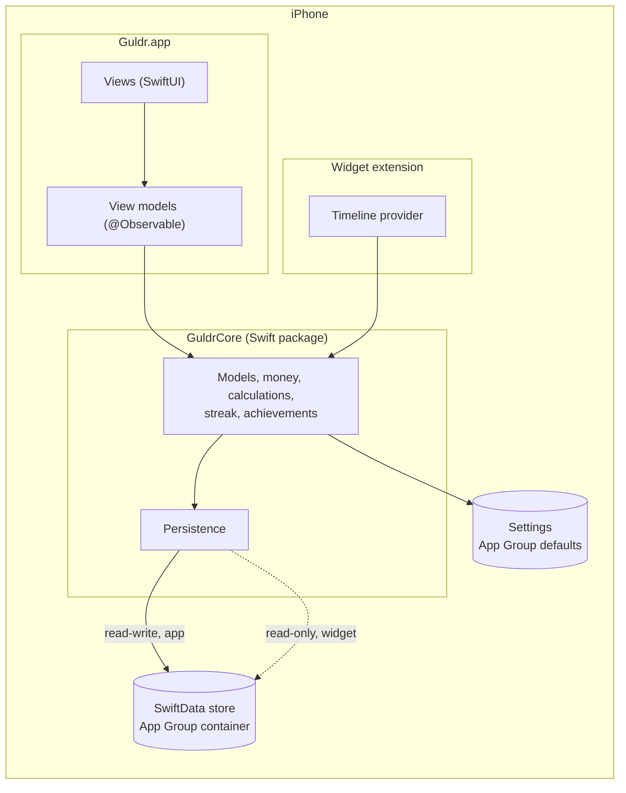

# Guldr

*Your gold, in order.* A local-first personal finance app for iPhone: everything stays on the device, with no account and no servers.

**Status:** v1.0.0, preparing the App Store release · [Changelog](CHANGELOG.md)

## Features

- **Transactions:**
  - income and expenses from a keypad-first add sheet;
  - your own categories;
  - a searchable list grouped by day;
  - every amount stored with its currency.
- **Home:** balance, the month's income, expenses and savings rate, the budget at a glance.
- **Budgets:** a monthly limit per category, alerts at 80 % and 100 %, last month copied in one tap.
- **Analytics:** income against expenses over 1, 3, 6 or 12 months and spending by category, with Swift Charts and Audio Graphs.
- **Habit loop:**
  - an opt-in daily reminder;
  - a logging streak with repair and freezes;
  - bronze, silver and gold achievements that only count complete months;
  - share cards that never show an amount.
- **Privacy:**
  - Face ID lock;
  - amounts hidden from widgets and lock-screen alerts on request;
  - a [privacy policy](https://mauroargudev.github.io/Guldr/privacy/) that fits in one sentence: nothing is collected.
- **Also:** small and medium widgets, CSV export, English and Spanish, VoiceOver, Dynamic Type and Reduce Motion throughout.

## Stack

| Area | Choice |
|---|---|
| UI | SwiftUI, native components first, a token-based [design system](docs/design/DESIGN.md) |
| State | MVVM with `@Observable` view models, main actor by default ([ADR 003](docs/decisions/003-concurrency-defaults.md)) |
| Data | SwiftData with a versioned schema and lightweight migrations, CloudKit-compatible models ([ADR 007](docs/decisions/007-persistence-and-widget-data.md)) |
| Money | `Int64` minor units plus an ISO 4217 code, never `Double` ([ADR 005](docs/decisions/005-money-representation.md)) |
| Domain | `GuldrCore`, a Swift package shared by the app and the widget, tested on macOS without a simulator ([ADR 006](docs/decisions/006-guldr-core-package.md)) |
| Charts | Swift Charts with accessibility chart descriptors |
| Widgets | WidgetKit, reading the store read-only from the App Group |
| Quality | Swift 6 strict concurrency, Swift Testing, SwiftLint with zero warnings, GitHub Actions CI |

## Architecture

All the logic that can be pure lives in `GuldrCore`: money, month calculations, budgets, the streak, achievements and the monthly recap. The app adds views, view models and the system integrations (notifications, Face ID, sharing). There is no backend; iCloud sync is planned for v1.1 and the models are already CloudKit-compatible. Details in [`docs/ARCHITECTURE.md`](docs/ARCHITECTURE.md); every non-obvious decision has an [ADR](docs/decisions/).

## Requirements
- Xcode 27 or later (project format compatible with Xcode 26)
- iOS 26.0+ device or simulator

## Run
1. Clone the repo and open `Guldr.xcodeproj`.
2. Run `git config core.hooksPath .githooks` once.
3. Select your team in Signing & Capabilities for both targets (App Group: `group.com.argudev.guldr`).
4. Run the `Guldr` scheme. To try it with a heavy history, add the launch argument `-seedTransactions 5000`, or `-demoData` for the mockups' realistic six months (Debug builds only, on an empty store).

Tests: `swift test --package-path Packages/GuldrCore` for the domain, and the `Guldr` scheme's test action for the app.

## Documentation
- Architecture: [`docs/ARCHITECTURE.md`](docs/ARCHITECTURE.md)
- Design system: [`docs/design/DESIGN.md`](docs/design/DESIGN.md)
- Workflow, versioning and Definition of Done: [`docs/WORKFLOW.md`](docs/WORKFLOW.md)
- Roadmap: [`docs/ROADMAP.md`](docs/ROADMAP.md)
- v1.0 delivery plan: [`docs/plan/v1.0.md`](docs/plan/v1.0.md)
- Architecture decisions: [`docs/decisions/`](docs/decisions/)
- Privacy policy and support: [`docs/PRIVACY.md`](docs/PRIVACY.md), [`docs/SUPPORT.md`](docs/SUPPORT.md)
- Project bootstrap: [`docs/setup/BOOTSTRAP.md`](docs/setup/BOOTSTRAP.md)

© 2026 Mauricio Argumedo. All rights reserved.
