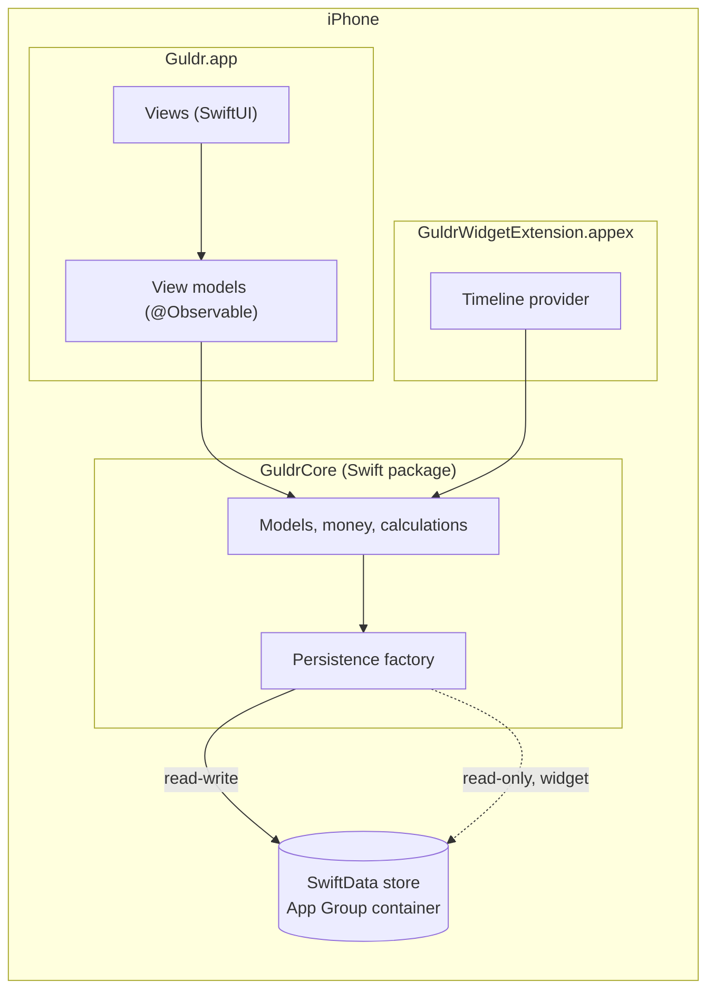

# Architecture

How Guldr is put together: targets, configuration, folder structure and the rules each layer follows. Decisions behind these choices are recorded in [`decisions/`](decisions/).

> Status: v1.0, feature complete. iCloud sync (v1.1) is the next planned change; see the [roadmap](ROADMAP.md).

## Overview



Guldr is local-first: all data lives on the device, in a SwiftData store inside the shared App Group container so the widget can read it ([ADR 007](decisions/007-persistence-and-widget-data.md)). The domain — models, money, calculations — lives in the `GuldrCore` package shared by the app and the widget ([ADR 006](decisions/006-guldr-core-package.md)). There is no backend. iCloud sync is planned for v1.1 and the models are already CloudKit-compatible ([roadmap](ROADMAP.md)).

## Targets

| Target | Product | Bundle ID | Role |
|---|---|---|---|
| `Guldr` | `Guldr.app` | `com.argudev.guldr` | The app |
| `GuldrWidgetExtension` | `GuldrWidgetExtension.appex` (embedded in the app) | `com.argudev.guldr.widget` | Home screen widgets |
| `GuldrTests` | `GuldrTests.xctest` (hosted in the app) | `com.argudev.GuldrTests` | App-hosted tests (Swift Testing) |

| Package | Products | Linked to | Role |
|---|---|---|---|
| `Packages/GuldrCore` | `GuldrCore` library, `GuldrCoreTests` | `Guldr`, `GuldrWidgetExtension` | Domain layer; iOS 26 and macOS 26 (macOS only to run `swift test` without a simulator); Swift 6 with default `nonisolated` isolation |

All app targets: iOS 26.0, iPhone only, Swift 6 language mode, `MainActor` default isolation and Approachable Concurrency ([ADR 001](decisions/001-ios-26-minimum.md), [ADR 003](decisions/003-concurrency-defaults.md)). There is no UI test target; UI is verified with previews and on device.

## Configuration

| What | Where | Notes |
|---|---|---|
| Version, build number, deployment target, App Group ID | [`Config/Shared.xcconfig`](../Config/Shared.xcconfig) | Included by `Debug.xcconfig` and `Release.xcconfig`, assigned at project level. Targets have no overrides. |
| App Group at runtime | Info.plist key `AppGroupID` = `$(APP_GROUP_ID)` | Code reads the group from the bundle instead of hard-coding it; covered by `ConfigurationTests`. |
| Entitlements | `Guldr/Guldr.entitlements`, `GuldrWidgetExtension.entitlements` | App Groups only. iCloud is intentionally absent until v1.1. |
| Secrets | `Config/Secrets.xcconfig` | Gitignored; none needed yet. |

Identifiers are explained in [ADR 002](decisions/002-identifiers.md).

## Folder structure

The app target uses a synchronized folder: every file under `Guldr/` belongs to the app target automatically. Folders are created with their first file; empty placeholders are not committed because Xcode would copy them into the bundle.

```
Guldr/
├── App/                 Entry point, store and settings loading, first-launch gate, tab bar, router, app-wide services
├── Core/
│   ├── DesignSystem/    Typography, spacing and reusable components built on GuldrColors
│   └── Extensions/      Small, generic extensions (formatting, dates)
├── Features/
│   ├── Dashboard/       One folder per feature: views, view model, components
│   ├── Transactions/
│   ├── Budget/
│   ├── Charts/
│   ├── Onboarding/      First launch: welcome and currency picker
│   ├── Categories/      Settings › Categories: the list and the category sheet
│   ├── Export/          Settings › Export transactions: the range, the CSV file and the share
│   ├── Lock/            Face ID lock: service, state machine, lock screen and its window
│   ├── Notifications/   Budget alerts and the daily reminder: the UserNotifications service and both centers
│   ├── Streak/          The logging streak: its center, Home's chip, the sheet, the setting
│   ├── Achievements/    The achievement center, medals, their words and the gallery
│   ├── Share/           Share cards, their renderer and sheet, and the monthly recap's library and views
│   └── Settings/        Settings and About
├── Resources/           Asset catalogs, String Catalogs (strings and InfoPlist), privacy manifest
├── Info.plist           Stays at the root: referenced by INFOPLIST_FILE
└── Guldr.entitlements   Stays at the root: referenced by CODE_SIGN_ENTITLEMENTS
GuldrWidget/             Widget extension: timeline provider, small and medium views, its String Catalog, privacy manifest and Info.plist
GuldrTests/              App-hosted tests (only what needs the app bundle)
Packages/GuldrCore/      Domain package (ADR 006)
├── Sources/GuldrCore/
│   ├── Money/           Money, currencies and the currency picker's options, keypad input, formatting
│   ├── Dates/           YearMonth, day labels
│   ├── Models/          SchemaV1, the @Model types, default categories and their seeder
│   ├── Persistence/     PersistenceController, PersistenceError, PreviewData
│   ├── Settings/        AppSettings: active currency and first-launch flag (ADR 010)
│   ├── Navigation/      DeepLink: the guldr:// URLs shared with the widget
│   └── Calculations/    MonthSummary, BudgetStatus, CategoryBreakdown, CashFlowSeries, TransactionQuery
└── Tests/GuldrCoreTests/ Mirrors Sources
Config/                  xcconfig files
docs/                    Design, decisions, workflow, roadmap and setup runbook
```

Present today: `App/`, `Core/DesignSystem/`, `Core/Extensions/`, `Features/` (Onboarding, the add sheet in Transactions and a placeholder root per tab), `Resources/`, `Info.plist`, `Guldr.entitlements`. The rest appears as the features are built. Models and persistence live in `GuldrCore`, not in the app target, so the widget and `swift test` share them.

## Layers

### Views
SwiftUI only. Views render state and forward user intent; they hold no business logic. Native components first (`NavigationStack`, `TabView`, sheets, segmented `Picker`), styled with the design system ([DESIGN.md](design/DESIGN.md)). Every view has light and dark previews. Reusable components live in `Guldr/Core/DesignSystem/` (tokens, typography, cards, rows, rings, chips); every animation goes through `Motion` and every haptic through `Haptics`, which handle Reduce Motion (enforced by SwiftLint custom rules). Debug builds include a design system gallery for review on a device.

### Navigation and first launch
`GuldrApp` opens the store and the settings through `AppDataLoader`. `LaunchGate` shows the welcome screen until first launch is completed (currency chosen), then `RootView`: the native tab bar with Home, Transactions, Budget and Analytics, one `NavigationStack` each, and the Add button as the separated tab next to the bar (a `.search`-role tab whose selection opens the add sheet instead of switching tabs).

`AppRouter` (`@Observable`, in the environment) owns the selected tab and the presented `AppSheet` (add or edit a transaction, edit a budget), so any screen can open a sheet. Deep links arrive through `.onOpenURL` and are parsed by `DeepLink` in `GuldrCore`, which the widget also uses to build them: `guldr://add` opens the add sheet over the current tab, `guldr://budget` and `guldr://home` close any sheet and select their tab. The `guldr` scheme is registered in `Info.plist`.

### Adding and editing transactions
`AddTransactionViewModel` (`Features/Transactions/`) backs one sheet for adding and editing; an edited transaction is passed by `PersistentIdentifier` and fetched by the model. The form edits plain values, so Cancel needs no undo; `save()` and `delete()` save the `ModelContext`, roll back on failure and throw a typed `EditorError`. For expenses, `save()` compares the month's `BudgetStatus` before and after (`categoriesNewlyOver(since:)` in `GuldrCore`) and returns `.saved` or `.crossedBudget`; `AppRouter.finishSave(_:)` closes the sheet and `RootView` plays the success or warning haptic, because the sheet is already gone. Seeded category names are translated at display time (`Category.displayName`), so an empty description is stored empty and shown as its category.

### Dashboard
`DashboardView` (`Features/Dashboard/`) keeps three `@Query`s: all transactions, all budgets, and the five newest transactions (`fetchLimit`), so Recent never reads the whole history. `DashboardModel`, like the list model, holds no context: `update(transactions:budgets:recent:currencyCode:)` maps `MonthSummary` (all-time balance, the month's income, expenses and savings rate) and `BudgetStatus` (the month's totals, categories over, days left) for the active currency, and builds the budget row's localized text and the recent rows. The view calls it when any query or the active currency changes and after a save. Entrances that should run once per launch (ledger lines, recent rows) are flags in a main-actor enum, not view state, so they survive Home being rebuilt.

### Budget
`BudgetView` (`Features/Budget/`) keeps two `@Query`s, all transactions and all budgets, and `BudgetModel` (no context, like the other screen models) holds the month on screen. `update(transactions:budgets:currencyCode:)` maps `BudgetStatus` for that month and the active currency into the overview card, one alert per category over its limit and the category rows, and says whether last month has budgets to copy. The view calls it when the queries, the month or the currency change and after a save. Editing goes through `EditBudgetModel`, opened by `AppSheet.editBudget(YearMonth)`: plain text fields per expense category, read in the user's locale; nothing touches the store until `save()`, which inserts, updates and deletes to match the fields (removing duplicates for one category), rolls back on failure and notifies `DataChangeNotifier`. The empty month's "Copy last month's budgets" uses the same model (`copyLastMonth()` then `save()`), so both paths save the same way. Saves end with `AppRouter.finishSave(.saved)`, which plays the success haptic and makes the screens refresh even when only a limit changed (an edit keeps the budget's identity).

### Analytics
`AnalyticsView` (`Features/Charts/`) keeps two `@Query`s, all transactions and all categories (archived ones name past slices), and the selected period in `@AppStorage`: a preference of this screen only, so it stays out of the App Group. `AnalyticsModel` (no context) maps `CashFlowSeries` and `CategoryBreakdown` for the period ending with the current month, in the active currency, into the totals, the bars (labels and titles formatted in the model, a unique key per bar because one-letter month labels repeat) and the donut's slices with their category colors (ADR 009). The view calls it when the queries, the period or the currency change and after a save. `CashFlowChart` and `CategoryDonut` take display values only; each adds per-mark accessibility labels and an `AXChartDescriptorRepresentable` for Audio Graphs. The model and the view take an injectable clock, so tests and previews run on the preview data set's date and reproduce the Charts mockup.

### Settings and categories
`SettingsView` (`Features/Settings/`) is a native `Form` pushed from Home. The currency row reuses the welcome screen's `CurrencyPickerView` through a binding whose setter writes through `Preferences.setActiveCurrency`, so every screen and the widget see the change; nothing is converted (ADR 005). `CategoriesView` (`Features/Categories/`) keeps one `@Query` of every category; `CategoriesModel` (no context) splits the selected kind into active categories, in the order `Category.pickable` uses, and archived ones. Reordering renumbers the kind's `sortOrder` from 0, archiving keeps at least one active category per kind, and restoring puts a category last; each change saves the view's context and rolls back on failure. Neither changes a total, so neither notifies dependents. `CategoryEditorModel` backs the category sheet like the other editors: nothing touches the store until `save()` or `delete()`. A seeded category's translated name is written only when the user changes it, so an untouched one keeps following the device's language; names are unique per kind, ignoring case and accents; only custom categories without transactions can be deleted, taking their budgets (ADR 008), which notifies dependents. "Delete all data" calls `DataReset.eraseAll(in:)` in `GuldrCore`: one save deletes transactions, budgets and custom categories and restores the defaults in place (same identity, seeded names, symbols, colors and order, none archived); only then `Preferences.reset()` clears the currency and first launch, and `LaunchGate` shows the welcome screen.

### Lock
The Face ID lock follows [ADR 011](decisions/011-lock-policy.md). `LockService` (`Features/Lock/`) is the only code that touches LocalAuthentication: `LocalAuthenticationLockService` evaluates `.deviceOwnerAuthentication` with a fresh `LAContext` per call and maps `LAError` codes to a typed `LockError`. `AppLock`, an `@Observable` state machine with an injectable clock, owns the lock preferences in `AppSettings` (shared with the widget): it starts locked when the lock is on, records when the app goes to the background and relocks on the way back once the grace period has passed, asks on its own once per lock, and authenticates before turning the lock on or off. `LaunchGate` creates nothing but reports scene phases to it; the lock screen and the privacy cover are drawn by `LockOverlayWindow`, a second `UIWindow` at the alert level installed once the scene is known, so they cover whatever the app presents and the app keeps its state underneath. Tests drive `AppLock` with a scripted service.

### Budget alerts
`BudgetAlertCenter` (`Features/Notifications/`) runs after every save through `DataChangeNotifier`: it builds this month's `BudgetStatus` in the active currency and asks `BudgetAlertLedger` (`GuldrCore`) which 80 % and 100 % alerts are due; the ledger keeps the current month's sent thresholds in `AppSettings`, so each is sent once per category per month and a new month starts fresh. Delivery goes through `NotificationService`; `UserNotificationService` is also the notification center's delegate, created with the app, so banners show while Guldr is open. Every notification carries a `DeepLink` (Budget for alerts, the add sheet for the reminder); a tap records it in the service's `NotificationInbox`, which `RootView` observes, so a tap that launches the app is routed once the views exist. Bodies leave amounts out while the Face ID lock is on. Permission is asked in context: after a sheet closes, or the empty month's copy saves, with budgets in the store and iOS not yet asked, `RootView` shows Guldr's own pre-prompt once; only "Turn on" calls `requestAuthorization`. Tests drive the center with a fake service and an in-memory store.

`DailyReminderCenter` (same folder) sends one notification a day at the user's time. iOS can't skip a day of a repeating trigger, so `ReminderSchedule` (`GuldrCore`) lists the next 7 days as wall-clock components and the center keeps them as one-off `UNCalendarNotificationTrigger` requests named by day (`reminder-2026-10-23`): it removes the days no longer wanted and re-adds the rest. Today drops out once a transaction is dated today. It reschedules after every save (`DataChangeNotifier`), when the scene becomes active, and on `significantTimeChange` and time zone changes; the calls are chained, so an older answer never lands after a newer one. Its pre-prompt follows the budget alerts pattern: once, after a sheet closes with at least one transaction saved, and not while the budget alerts offer shows. The reminder's "Add expense" action and a tap both open the add sheet. Tests use the same fake service.

### Streak
The logging streak follows [ADR 012](decisions/012-logging-streak.md).

- **Rules (`GuldrCore`):**
  - `LocalDay` is a Gregorian day stored as `yyyymmdd`.
  - `LoggedDays` records a new transaction's day or "No spending" while the day is still open (today, or yesterday until today ends), inside the caller's save. It also imports the history once.
  - `LoggingStreak` derives the current and best runs, the freezes, each day's state and the milestones from the days alone. There's no counter to drift, and the widget and the app agree.
- **Recording:** `AddTransactionViewModel` logs a new transaction's day in the same save; an edit never does.
- **`StreakCenter`:**
  - **Data:** imports the history on the first start, rereads the streak after every save, on scene active and at midnight, and marks "No spending";
  - **Milestones:** spots a milestone once per run (remembered in `AppSettings` by the run's first day). `RootView` shows the card once no sheet is up.
- **Notifications:** the reminder's "No spending today" action is recorded in `NotificationInbox` like a tap. The action opens the app, and `RootView` marks the day.
- **Widget:** the medium widget reads the same days through `LoggedDays.streak`.

### Achievements
Achievements follow [ADR 013](decisions/013-achievements.md).

- **Catalog and evaluation (`GuldrCore`):**
  - `AchievementCatalog` holds the eight achievements and their thresholds.
  - `AchievementEvaluator` turns transactions, budgets and logged days into one value per achievement. Money ones only count complete months: over, with 90 % of their days logged or frozen.
  - The evaluator also combines the values with the stored tiers, keeping the higher one, and lists the tiers newly reached.
  - `EarnedAchievements` reads and records the `EarnedAchievement` rows.
- **`AchievementCenter`** evaluates after every save, on scene active and on a new day, stores new tiers and queues them; its first evaluation records the history silently.
- **`RootView`** shows one `MomentBanner` at a time once no sheet is up: a streak milestone first, then each unlock.
- **Words:** `GuldrCore` keeps no display text. Names, summaries, families and tiers live in the app (`Achievement+Text.swift`); tiers have their own keys, since "Gold" is already a category color.

### Share cards and monthly recap
- **`MonthlyRecap` (`GuldrCore`)** reviews a month with counts, percentages and identifiers only, never `Money`, so a card can't show an amount by construction. It reads the same days, budgets and tiers as the streak and achievements.
- **`RecapLibrary`:**
  - lists the past months with anything in them;
  - decides whether Home offers last month (days 1–7, until closed in `Preferences`);
  - builds a `RecapCard` with the top category's shown name.
- **Rendering:** `ShareCardView` draws a card at a fixed size and Dynamic Type; `ShareCardRenderer` renders it with `ImageRenderer` at 3× in the app's appearance and language.
- **Sharing:** `ShareCardSheet` opens the system share sheet through `ActivitySharing` (`UIActivityViewController`) rather than `ShareLink`, since each destination needs something different:
  - the image goes as a `UIImage`, with the card's title and thumbnail in the sheet's header;
  - the short text goes to every app except Instagram, whose extension rejects an image with text or raw PNG data ("Content currently unavailable"), found in the author's device test.
- **Entry points:** the unlock moment goes through `AppRouter` (`shareAchievement`, `recap`); the gallery uses its own sheet, by identifier, so the sheet always reads current data.

### Export
`ExportView` (`Features/Export/`) keeps one `@Query` of transactions; `ExportModel` copies them once into `CSVExporter.Row`s (plain values: SwiftData models can't leave their context) and filters the copies by range. `ExportFile` is the `Transferable` behind `ShareLink`: its `FileRepresentation` calls `CSVExporter.data(for:)`, which is `@concurrent`, only when the user picks a destination, and writes `Guldr-YYYY-MM-DD.csv` to the temporary directory. `CSVExporter` (`GuldrCore`) writes RFC 4180 with CRLF line endings, ISO 8601 dates with the offset, signed amounts from the minor units with the currency's digits, and English headers and `type`.

### Widgets
One `StaticConfiguration` (`GuldrWidget/`), small and medium. `SummaryProvider` is `nonisolated`, since WidgetKit calls it off the main actor: per timeline it opens the store read-only and the App Group's settings, and builds one entry with `WidgetSummary` from `GuldrCore`, the Dashboard's own month calculations plus the three newest transactions ([ADR 007](decisions/007-persistence-and-widget-data.md)). Before first launch the entry says so; the gallery gets `WidgetSummary.sample`. The timeline asks again at the next midnight, and the app reloads it through `DataChangeNotifier` after every save and after changing the currency, the lock, widget privacy, first launch or "Delete all data". Amounts go through one view with `.privacySensitive()`, redacted while `AppSettings.hidesWidgetAmounts` is on (Settings › Security › "Hide amounts in widgets", independent of the lock since 2026-10-23). The app's design system isn't in the widget target, so the widget keeps small equivalents (the glyph as a stroke, ledger lines) and its own String Catalog; colors come from the shared `GuldrColors` catalog. Taps open `guldr://home`; the medium widget's + opens `guldr://add`.

### Transactions list
`TransactionsView` (`Features/Transactions/`) keeps two `@Query`s, transactions newest first and the non-archived categories for the filter menu, so SwiftData keeps the screen current. `TransactionsListModel` holds the filters in a `TransactionQuery` and no `ModelContext`; reading SwiftData properties is the expensive part, so `update(transactions:currencyCode:)` copies each transaction once into a `TransactionQuery.Item` and prebuilds its row, and filters or search only re-run the query on those copies (about 4–8 ms for 5,000 transactions in Release). The view calls `update` when the query's results or the active currency change, and after a save, because an edited transaction keeps its identity and the results compare equal. Deleting goes through the model with the view's context, rolls back on failure and notifies dependents, like the add sheet. Debug builds can fill an empty store with `-seedTransactions <count>` (`App/DebugSeed.swift`) to try the screens with a heavy history.

### View models
One `@Observable` final class per screen, owned by the view with `@State`. They expose display-ready values and actions, and depend on the data layer through protocols so they can be tested with in-memory stores or fakes. Main-actor isolated by default.

### Data
Everything about the store lives in `GuldrCore` ([ADR 007](decisions/007-persistence-and-widget-data.md)).

- **Models:** `Transaction`, `Category` and `Budget`, declared in `SchemaV1` (a `VersionedSchema`), `LoggedDay` (ADR 012), added in `SchemaV2`, and `EarnedAchievement` (ADR 013), added in `SchemaV3`; each version lists the unchanged classes too. `GuldrMigrationPlan` has two lightweight stages, V1 → V2 → V3, tested by opening a V1 store from disk. Top-level aliases point at the current version. They stay CloudKit-compatible: no `@Attribute(.unique)`, optional relationships with inverses, a default for every property, only plain stored types. Amounts are `Int64` minor units plus `currencyCode`, exposed as `Money` ([ADR 005](decisions/005-money-representation.md)); enums are stored as raw strings behind computed properties; `Budget.yearMonth` is `YearMonth.rawValue` ([ADR 008](decisions/008-categories-and-month-keys.md)). Category colors come from a curated palette ([ADR 009](decisions/009-category-color-palette.md)).
- **Container:** `PersistenceController(mode:)` opens `<App Group>/Library/Application Support/Guldr.store` read-write for the app (`.app`), read-only for the widget (`.widget`), or in memory for tests and previews (`.inMemory`). CloudKit is off (`cloudKitDatabase: .none`). The app and in-memory modes seed the default categories on every open; seeding matches `systemKey`s, so it never duplicates.
- **Errors:** opening throws `PersistenceError`: `appGroupUnavailable`, `storeCreationFailed(underlying:)`, or `storeNotFound` (widget only, before the app's first launch). In the app, `AppDataLoader` turns the result into the app or `StoreErrorView`, a calm screen with a retry and a prefilled support mail. There is no `fatalError` and no silent fallback to an empty store.
- **Settings:** the active currency and the first-launch flag live in the App Group's `UserDefaults` through `AppSettings`, so the widget reads them too ([ADR 010](decisions/010-app-settings-storage.md)). The app observes them through `Preferences`.
- **After saves:** the app calls `DataChangeNotifier.dataDidChange()` (from the environment), the one place that refreshes dependents: `LaunchGate` gives it the streak and achievement refreshes, the widget reload, the budget alert check and the reminder's reschedule.
- **Previews:** `PreviewData.makeController()` returns an in-memory store with April–September 2026 that reproduces the mockups' numbers, with "now" fixed at `PreviewData.referenceDate` (Sept 28, 9:41).

Names: outside `GuldrCore`, `Transaction` collides with SwiftUI's and `Category` with the Objective-C runtime typedef re-exported by Foundation. Client modules declare module-level aliases (`typealias Category = GuldrCore.Category`), which win over imported names.

### Widget store
`WidgetStore.open()` calls `PersistenceController.widgetAccess(infoDictionary:)` with the extension's own Info.plist and gets `.ready(container)`, `.noDataYet` or `.unavailable(error)`. The widget shows its empty state for the last two and never writes; SwiftData rejects a save on the read-only store. Timelines use the same `GuldrCore` calculations as the app (see [Widgets](#widgets)).

## Concurrency

In the app and the widget, code is main-actor isolated unless it opts out. `GuldrCore` keeps Swift's default `nonisolated` isolation: its value types are `Sendable` and callable from any context. Work that must leave the main actor is explicit: `nonisolated` for value types and helpers callable from anywhere, `@concurrent` for functions that run in the background (CSV export, heavy aggregation). `@unchecked Sendable` is never used without a comment explaining why. See [ADR 003](decisions/003-concurrency-defaults.md).

## Testing and CI

Tests use Swift Testing and in-memory SwiftData containers; persistence tests use a temporary folder as the App Group. Domain tests live in `GuldrCore` and run with `swift test` on macOS (`core-tests` CI job, no simulator, plus strict SwiftLint). The few app-hosted tests run on a pre-booted simulator (`test` job). Both jobs are required and fail if no test ran. Details in [WORKFLOW.md](WORKFLOW.md#testing) and [WORKFLOW.md](WORKFLOW.md#continuous-integration).
